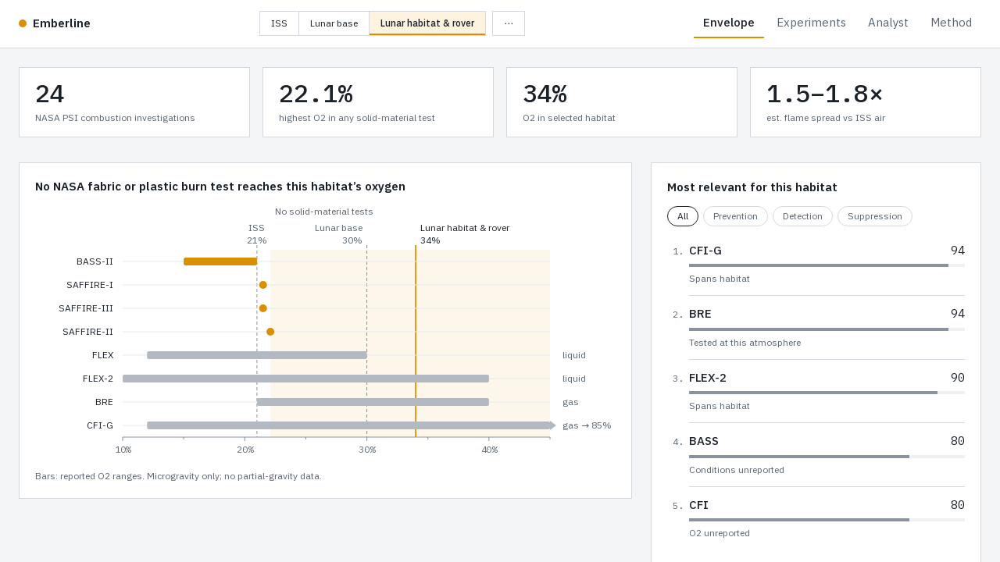

# Emberline

Fire-safety insights from NASA microgravity combustion data.

Emberline maps the 24 combustion investigations in NASA's Physical Sciences Informatics (PSI) database against the atmospheres planned for crewed spacecraft and lunar habitats, ranks the experiments that matter for a given habitat, and answers questions with citations to NASA sources.

**Live demo:** https://emberline-alpha.vercel.app

Built for the NASA Space Apps Challenge 2026 (Flame in Freefall).



## Background

Lunar habitats, landers and pressurized rovers are planned at 8.2 psia and 34% oxygen. Crews breathe that air normally because the oxygen partial pressure stays close to sea level, but flammability depends on the oxygen fraction. A published NASA correlation puts flame spread over thin fabrics at roughly 1.5 to 1.8 times the rate in ISS air, and microgravity limits can sit up to about 4% O2 below the 1 g NASA-STD-6001 Test 1 limits.

Across the 24 PSI investigations, no solid-material (fabric or plastic) burn test goes above 22.1% O2. Emberline makes that gap, and the experiments closest to it, easy to see.

## Features

- **Envelope.** Each investigation's reported oxygen range against the ISS, lunar base and lunar habitat atmospheres.
- **Ranking.** A transparent relevance score for the selected habitat and focus (prevention, detection, suppression).
- **Experiments.** Searchable table of all 24 investigations with fuels, conditions, findings, DOIs and side-by-side comparison.
- **Analyst.** Plain-language questions answered only from retrieved NASA passages. Every sentence carries a citation that the server checks.
- **Method.** Data provenance, model caveats, evaluation results and references.

## How it works

| Component | Approach |
|---|---|
| Data | PSI investigation pages and ISA metadata parsed into structured records; 154 CFI-G test points; 30 cited findings; 63 sources |
| Coverage | Habitat atmosphere compared with each investigation's reported O2 and pressure ranges |
| Ranking | `100 x (0.40 conditions + 0.20 fuel + 0.25 focus + 0.15 flight)` |
| Spread estimate | `(X_O2 / 0.21)^n x (P / 14.7 psia)^0.05`, n = 0.9 to 1.25 (Olson et al., 2008) |
| Analyst | BM25 retrieval over 142 passages, Gemini generation, server-side citation check (In-Context RALM, Ram et al., 2023; ALCE, Gao et al., 2023) |

Values a source does not report are left empty and shown as "not reported". No numbers are filled in by estimation.

## Evaluation

20 questions with expected sources, evaluated with `gemini-3.5-flash`:

| Metric | Score |
|---|---|
| Source hit rate | 0.95 |
| Citation precision | 0.84 |
| Citation recall | 0.68 |
| Unsupported sentences | 0.00 |

"Supported" means the cited passage was among those retrieved. It is a citation validity check, not a full entailment check.

## Getting started

Requires Node.js 20 or later.

```bash
git clone https://github.com/TerminalRocketship45/Emberline.git
cd Emberline
npm install
cp .env.example .env.local
npm run dev
```

Add a `GEMINI_API_KEY` to `.env.local` (the free tier works). Without a key, the analyst falls back to cached and extractive answers.

Rebuild the data from `raw/`:

```bash
python3 pipeline/build_sources.py
python3 pipeline/build_data.py
python3 pipeline/build_investigations.py
python3 pipeline/build_corpus.py
python3 pipeline/validate.py
```

Run the evaluation:

```bash
node --experimental-strip-types scripts/eval.ts
```

## Project structure

```
app/            Next.js pages and the /api/ask route
components/     Dashboard views and the analyst panel
lib/            Ranking, spread model, data loading, analyst pipeline
data/           Generated JSON used by the app
pipeline/       Python scripts that build data/ from raw/
raw/            PSI page text and the CFI-G experimental table
scripts/        Analyst evaluation
```

## Data and credits

NASA PSI data is released under CC0-1.0. Sources for every finding are listed in the app's Method tab and in `data/sources.json`. AI coding assistants were used during development; all quantitative claims trace to cited sources.

Built with Next.js, Tailwind CSS and IBM Plex. This project is not affiliated with or endorsed by NASA.
